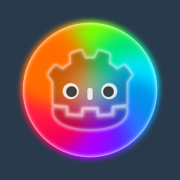
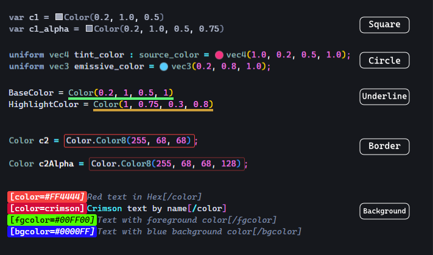

<p align="center">
  
</p>

# Godot Color Visualizer for Visual Studio Code

 [](https://marketplace.visualstudio.com/items?itemName=MerlinDuChaos.godot-color-visualizer) [](https://open-vsx.org/extension/merlinduchaos/godot-color-visualizer) [](https://opensource.org/licenses/MIT)

**Godot Color Visualizer** brings native color swatches, decorators, and color picking to your Godot game development workflow in Visual Studio Code.

Whether you code in **GDScript**, **C#**, write **GDShader** shaders, or edit **BBCode** rich text and **Godot Resources** (`.tscn`, `.tres`), this extension highlights your colors in real-time and lets you visually tweak them while **strictly preserving your original syntax and format**.

---

## ✨ Features

- **Multi-Language Godot Support**: Full coverage for GDScript, C#, GDShader, BBCode, and Godot resources.
- **Interactive Color Picker**: Click on any color to open the color picker and visually tweak your shades.
- **Format Preservation**: When picking a new color, the code is rewritten matching the exact style of the original expression:
  - Preserves C# float suffixes (`0.25f`)
  - Preserves integer ranges for `Color8` (`0` to `255`)
  - Respects your preferred float precision (e.g., `3` decimals)
  - Intelligently manages alpha channel inclusion (only adds alpha if translucent or originally present)
- **5 Sleek Display Styles**: Choose how colors are displayed in your editor:
  - `square` (Default VS Code native color box)
  - `circle` (Clean circular badge placed next to code)
  - `underline` (Subtle, elegant colored underline)
  - `border` (Crisp bounding box)
  - `background` (Translucent background highlight)
- **Custom User Patterns**: Define your own project-specific color variables, macros, or helper functions via regex in settings.

<p align="center">
  
</p>

---

## 🎨 Supported Syntaxes & Examples

### GDScript (`.gd`)
```gdscript
var primary = Color(0.2, 0.8, 0.4)          # RGBA Floats (0.0 to 1.0)
var translucent = Color(1.0, 0.0, 0.0, 0.5)  # With Alpha
var ui_color = Color8(255, 128, 0)           # 8-bit integers (0 to 255)
var hex_color = Color("#4a90e2")             # Hex string constructor
var html_col = Color.html("#ff5722")         # HTML helper
var hsv_col = Color.from_hsv(0.5, 0.8, 1.0)  # HSV representation
var named = Color.CORNFLOWER_BLUE            # Standard Godot named constants
```

### C# (`.cs`)
```csharp
var background = new Color(0.1f, 0.1f, 0.15f);        // new Color with float suffix
var accent = Color.Color8(255, 68, 68, 255);          // Color8 integers
var hex = Color.FromHtml("#E74C3C");                  // FromHtml constructor
var hsv = Color.FromHsv(0.1f, 0.7f, 0.9f);            // FromHsv constructor
var constant = Colors.Crimson;                        // Named constant from Colors class
```

### GDShader (`.gdshader`)
```glsl
vec3 albedo = vec3(1.0, 0.5, 0.2);                    // RGB vector
vec4 tint = vec4(0.2, 0.4, 0.8, 1.0);                 // RGBA vector
```

### BBCode & Godot Resources (`.tscn`, `.tres`)
```bbcode
[color=#FF4444]Danger![/color]
[bgcolor=yellow]Highlighted Text[/bgcolor]
[fgcolor=#00FF00AA]Translucent Green[/fgcolor]
```

---

## ⚙️ Configuration Settings

Configure the visualizer in **Settings** (`Ctrl+,`) under **Extensions > Godot Color Visualizer**:

| Setting | Type | Default | Description |
| :--- | :--- | :--- | :--- |
| `godotColorVisualizer.displayStyle` | `string` | `"square"` | Visual style used to display colors: `"square"`, `"circle"`, `"underline"`, `"border"`, or `"background"`. |
| `godotColorVisualizer.enableCodeFiles` | `boolean` | `true` | Enable color visualization in code files (`.cs`, `.gd`, `.gdshader`). |
| `godotColorVisualizer.enableResourceFiles` | `boolean` | `false` | Enable color visualization in Godot resource & project files (`.tscn`, `.tres`, `project.godot`). |
| `godotColorVisualizer.floatPrecision` | `number` | `3` | Maximum number of decimal places when formatting float values (e.g., `0.333f`). |
| `godotColorVisualizer.customPatterns` | `array` | `[]` | Custom regular expressions with named capture groups to match custom color definitions. |

---

## 🧩 Custom Patterns

Have custom color wrappers, shader defines, or custom palette formats? You can define your own patterns in your `.vscode/settings.json`:

```json
{
  "godotColorVisualizer.customPatterns": [
    {
      "name": "My Custom Palette",
      "extensions": [".gd", ".cs"],
      "regex": "PALETTE_COLOR\\s*=\\s*(?<hex>#[0-9a-fA-F]{6})",
      "format": "hex"
    },
    {
      "name": "Custom Float RGB",
      "extensions": [".gd"],
      "regex": "MyColor\\((?<r>\\d*\\.?\\d+),\\s*(?<g>\\d*\\.?\\d+),\\s*(?<b>\\d*\\.?\\d+)\\)",
      "format": "rgba_float"
    }
  ]
}
```

Supported formats: `"rgba_float"`, `"rgba_8"`, and `"hex"`.

---

## ⌨️ Commands

| Command | Title | Description |
| :--- | :--- | :--- |
| `godotColorVisualizer.pickColor` | **Godot Color: Open Color Picker** | Opens the color picker for the color currently under the editor cursor. |

---

## 📄 License

This extension is licensed under the [MIT License](LICENSE).
